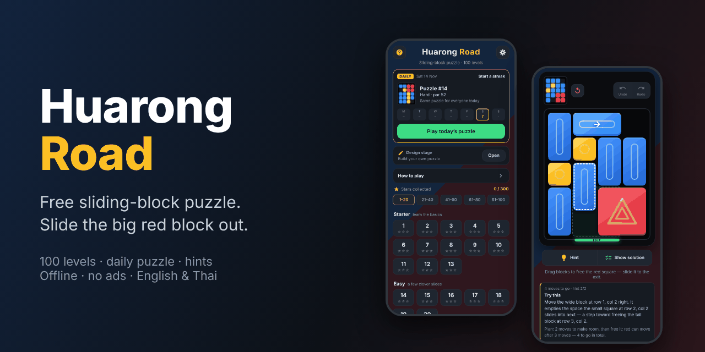
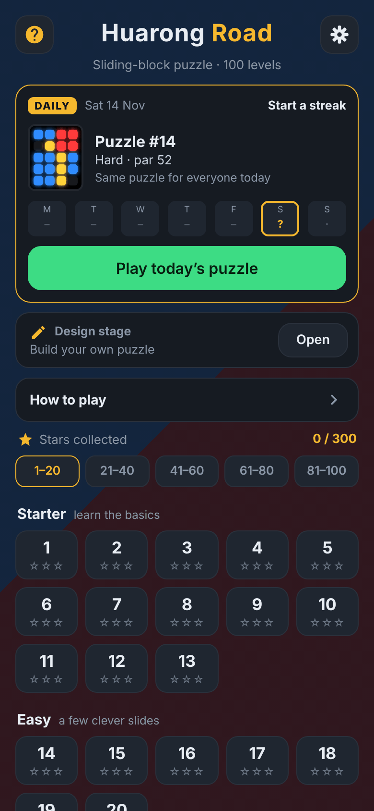
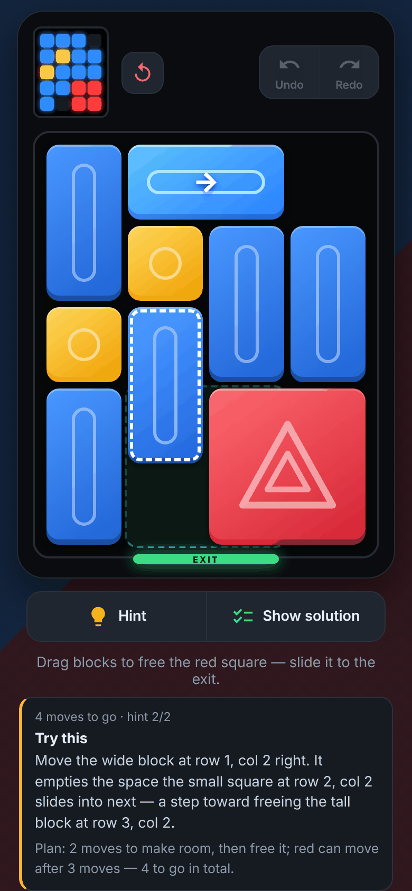
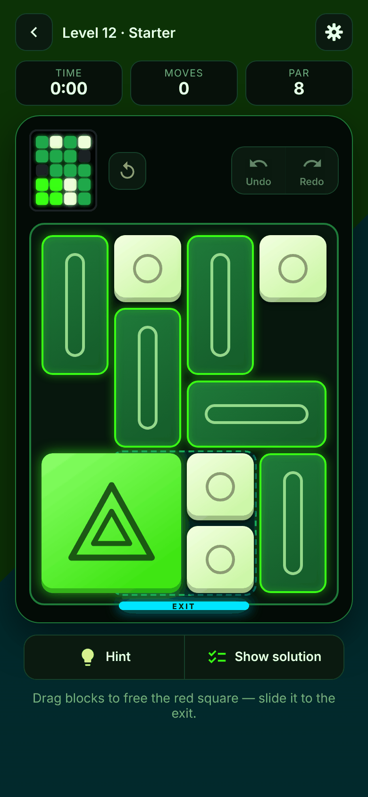
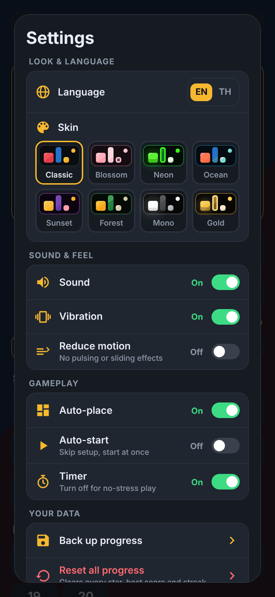

<p align="center">
  
</p>

<h1 align="center">Huarong Road</h1>

<p align="center">
  A free, offline sliding-block puzzle (Klotski / 華容道) for your phone or PC.<br>
  Slide the big red block out through the exit at the bottom.
</p>

<p align="center">
  <a href="https://sarail19th.github.io/huarong-road/"><b>▶ Play it in your browser</b></a>
  &nbsp;·&nbsp; installable on Android &nbsp;·&nbsp; no ads &nbsp;·&nbsp; no tracking &nbsp;·&nbsp; MIT
</p>

---

## Why this exists

I saw a physical Huarong Road toy on Shopee, the kind with a battery, and wondered if I should buy one to fidget with. Before spending money I wanted to try the puzzle on my PC or phone first. I couldn't find a free game that also worked offline, so I asked Claude to build one. This is the result: a small, no-nonsense version that I can play on the bus, with no ads and no sign-up.

It is a hobby project, written with [Claude Code](https://claude.ai/code).

## Screenshots

<table>
  <tr>
    <td align="center"><br><sub>Daily puzzle + 100 levels</sub></td>
    <td align="center"><br><sub>Hints that explain why</sub></td>
    <td align="center"><br><sub>8 skins (Neon shown)</sub></td>
  </tr>
  <tr>
    <td align="center"><br><sub>Settings</sub></td>
    <td align="center"><br><sub>English and Thai</sub></td>
    <td></td>
  </tr>
</table>

## How to play

- Drag blocks to open a path for the **big red 2×2 block** and slide it to the **EXIT** at the bottom centre.
- One move = one block slid in a straight line, any distance. Fewer moves is better.
- Each level has a **par**, the proven minimum number of moves (found by an exhaustive search, not guessed).
- Stars: finish in par or fewer for ★★★, within 1.4× par for ★★.
- Stuck? Use **Hint** (two taps: first the goal, then the exact move and why) or **Show solution**. Viewing the solution means that level earns no stars.

## Features

- **100 levels** from Starter upward, each with a verified optimal par.
- **Daily puzzle**, generated on your device from the date: same puzzle for everyone, works offline, harder at the weekend. Streak and week row included.
- **Design stage**: build your own puzzle (up to 50). The solver checks it is solvable, reports the minimum moves and grades it.
- **Explained hints**, plus a **progress marker** (closer / no progress / further) after each move once you have used a hint.
- **Solution viewer**: step or auto-play the optimal line.
- Undo / Redo, Restart, best score per level, optional timer (turn it off for no-stress play).
- **8 skins**, English / Thai (ไทย), sound, vibration and reduce-motion switches.
- **Back up and restore** your progress with a copyable code or a text file.
- Fully **offline** after the first load, installable as an app. No accounts, no network calls.

## Install on your phone

1. Open the [live page](https://sarail19th.github.io/huarong-road/) in Chrome on Android.
2. Menu (⋮) → **Add to Home screen** / **Install app**.
3. It now runs offline. Your progress is stored on the device only, so use *Settings → Back up progress* before clearing browser data or switching phones.

The in-app **Update** button (bottom of the menu) fetches the newest version without touching your progress.

## Develop

Plain HTML, CSS and JavaScript. No framework, no runtime dependencies. The build inlines everything into one self-contained `dist/index.html`.

```bash
node gen/gen.js        # regenerate src/levels.js (~25 s, deterministic)
node test/test.js      # must print "OK: 100 levels verified"
node build.js          # produce dist/ (page, manifest, service worker)
python3 gen/icons.py   # PWA icons into dist/ (needs Pillow; run after build)
python3 gen/shots.py   # store screenshots for the manifest (needs Playwright)
node test/pwa_test.js  # manifest, icons, screenshots, service-worker list
python3 test/ui_test.py  # end-to-end test at a phone viewport (needs Playwright + Chromium)
```

To try it locally, serve `dist/` over `localhost` or https so the service worker registers (opening the file directly works too, just without the PWA parts).

### Project layout

| Path | What it is |
| --- | --- |
| `src/solver.js` | Board model and BFS solver (4×5 board, 20 cells) |
| `src/daily.js` | Date-seeded daily puzzle generator, shared with the tests |
| `src/levels.js` | **Generated** 100 levels (`{id, par, g}`), do not hand-edit |
| `src/game.js` | All UI logic: setup, play, hints, solution viewer, settings, design stage |
| `src/index.html`, `src/style.css` | Templates inlined by the build |
| `gen/` | Level generator, icon generator, store and README screenshot scripts |
| `build.js` | Builds `dist/` and stamps a content-hash build id |
| `test/` | Level verification, PWA checks, UI end-to-end test |
| `docs/` | Images used by this README (`gen/readme_shots.py` regenerates them) |
| `dist/` | Built site, committed and published by the GitHub Pages workflow |

More detail on conventions and rules for changing things is in [`CLAUDE.md`](CLAUDE.md).

### Deploying

`dist/` is committed. Pushing to `main` runs `.github/workflows/pages.yml`, which publishes `dist/` to GitHub Pages, so rebuild (`node build.js`) before you push.

### Social preview

`docs/social-preview.png` is 1280×640, GitHub's recommended size. GitHub cannot take it from the repo, so upload it once under **Settings → General → Social preview**. Regenerate it (and the other README images) with `python3 gen/readme_shots.py` after `node build.js`.

## Credits and license

- Code: MIT, see [`LICENSE`](LICENSE).
- Button icons are adapted from Google's [Material Design icons](https://github.com/google/material-design-icons) (Apache-2.0), see [`NOTICE.md`](NOTICE.md). The app icon, gear, globe and timer icons are original to this project.
- Huarong Road (華容道) is named after the Huarong Pass episode in *Romance of the Three Kingdoms*, where Cao Cao slips away past his pursuers. The red block is Cao Cao. The in-app **About** (`?`) panel tells the story.
